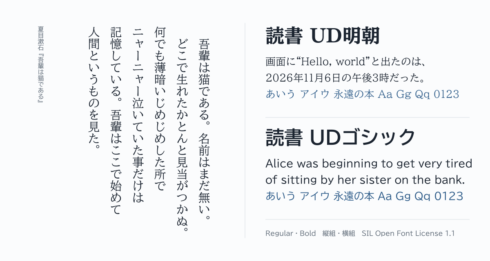

# Dokusho UD Mincho and Dokusho UD Gothic

[](https://github.com/hayatedayon/dokusho-ud-fonts/actions/workflows/build.yml)
[](https://github.com/hayatedayon/dokusho-ud-fonts/releases/latest)
[](https://github.com/hayatedayon/dokusho-ud-fonts/releases)
[](OFL.txt)
<br>

[](https://github.com/fonttools/fonttools)

[日本語](README.md)

Fonts for reading books. They are Morisawa's [BIZ UDMincho](https://github.com/googlefonts/morisawa-biz-ud-mincho) and [BIZ UDGothic](https://github.com/googlefonts/morisawa-biz-ud-gothic) with only the Latin letters taken from BIZ UDP, the proportional version of the same design, so that text is set the way printed Japanese books are, both horizontally and vertically.



| | Dokusho UD Mincho | Dokusho UD Gothic |
| --- | --- | --- |
| Japanese name | 読書 UD明朝 | 読書 UDゴシック |
| Weights | Regular, Bold | Regular, Bold |
| Files | `DokushoUDMincho-Regular.ttf`, `.woff2` and so on | `DokushoUDGothic-Regular.ttf`, `.woff2` and so on |

## Download

Download the TTF or WOFF2 files from the [latest release](https://github.com/hayatedayon/dokusho-ud-fonts/releases/latest).

## Why

Horizontal Japanese books set kana, kanji and punctuation on a full-width grid (solid setting in the [Requirements for Japanese Text Layout](https://www.w3.org/TR/jlreq/)), and Latin letters in a proportional typeface. Neither BIZ UD nor BIZ UDP does that on its own.

| | Kana and punctuation | Latin letters |
| --- | --- | --- |
| BIZ UD | Full width, on the grid | Monospaced half width (`i` is as wide as `W`) |
| BIZ UDP | Their own widths (a full stop is 60% of full width, an opening bracket half) | Their own widths |
| **Dokusho UD** | **Full width, as BIZ UD** | **Their own widths, as BIZ UDP** |


The vertical forms (`vert`, `vrt2`) and vertical metrics of kana, kanji and punctuation, and the kanji of JIS levels 1 and 2, are those of BIZ UD.

## Tuned for reading and typesetting

- Kana, kanji and punctuation sit on a full-width grid (solid setting), and Latin letters have their own widths, so English words inside Japanese text are not split by gaps.
- In vertical text, quotation marks take the forms of the vertical quotes `〝 〟`. The text itself does not change, so copying and searching are not affected.
- Consecutive brackets and punctuation can be trimmed as in printed books (`halt`, `vhal`, `chws`, `vchw`), and headings can use proportional setting (`palt`, `vpal`).
- Latin kerning for frequent pairs is on by default.
- Fractions, superscripts, subscripts, tabular figures and half-width alphanumerics for tate-chu-yoko (`hwid`) are available.
- Symbols in Latin text take BIZ UDP's glyphs, so `It’s` and `“Hello”` have no full-width gaps around them.
- Japanese quotation marks (`ss01`), Latin symbols (`ss02`) and a ruby kana trial (`ss03`) can be selected when needed.
- Latin letters carry BIZ UDP's hinting, and the added digits carry vertical-only hinting.

The full list and examples are in [docs/FEATURES.en.md](docs/FEATURES.en.md).

## Usage

Install the fonts, or load them on the web like this:

```css
@font-face {
  font-family: "Dokusho UD Mincho";
  src: url("DokushoUDMincho-Regular.woff2") format("woff2"),
       url("DokushoUDMincho-Regular.ttf") format("truetype");
}

body {
  font-family: "Dokusho UD Mincho", serif;
  text-spacing-trim: normal; /* trim consecutive brackets and punctuation */
}
```

## Inherited from the original fonts

Greek and Cyrillic letters are full width, and few of the extended Latin letters are included. For Greek, Russian and similar text, combine these fonts with another Latin typeface.

## License

[SIL Open Font License 1.1](OFL.txt). Free for personal and commercial use, and free to bundle with apps and documents; the fonts may not be sold by themselves. The copyright notices of the original fonts are in OFL.txt.

Releases contain only the font files. The copyright notice and the full text of the license, which the OFL requires in each copy, are inside the fonts (the copyright and license fields of the name table), so the files alone are enough when you redistribute them.

These fonts are not affiliated with Morisawa. Please report problems as issues in this repository.

## Documents

- [Features and changes](docs/FEATURES.en.md)
- [Building and checking](docs/DEVELOPMENT.en.md)
- [Proofing records](docs/PROOFING.md) (Japanese)
- [Change log (FONTLOG.txt)](FONTLOG.txt)
