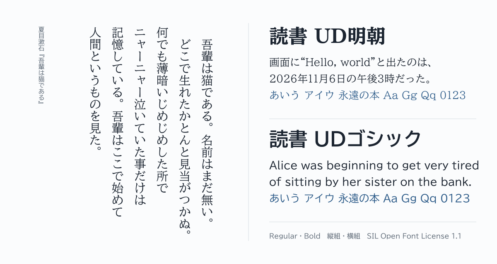

# 読書 UD明朝・読書 UDゴシック

[](https://github.com/hayatedayon/dokusho-ud-fonts/actions/workflows/build.yml)
[](https://github.com/hayatedayon/dokusho-ud-fonts/releases/latest)
[](https://github.com/hayatedayon/dokusho-ud-fonts/releases)
[](OFL.txt)
<br>

[](https://github.com/fonttools/fonttools)

[English](README.en.md)

本を読むためのフォントです。モリサワの [BIZ UD明朝](https://github.com/googlefonts/morisawa-biz-ud-mincho)・[BIZ UDゴシック](https://github.com/googlefonts/morisawa-biz-ud-gothic)を元に、欧字だけを同じデザインのプロポーショナルな BIZ UDP の字にしました。縦書きでも横書きでも、印刷された日本語の本と同じ組み方になります。



| | 読書 UD明朝 | 読書 UDゴシック |
| --- | --- | --- |
| 英語名 | Dokusho UD Mincho | Dokusho UD Gothic |
| ウェイト | Regular・Bold | Regular・Bold |
| ファイル | `DokushoUDMincho-Regular.ttf`・`.woff2` など | `DokushoUDGothic-Regular.ttf`・`.woff2` など |

## ダウンロード

[最新のリリース](https://github.com/hayatedayon/dokusho-ud-fonts/releases/latest)から、TTF または WOFF2 をダウンロードしてください。

## なぜ合成したか

日本語の横組の本は、仮名・漢字・約物を全角のマス目に並べ（[日本語組版処理の要件（JLReq）](https://www.w3.org/TR/jlreq/?lang=ja) のベタ組）、欧字はプロポーショナルの欧文書体で組みます。BIZ UD と BIZ UDP は、どちらか一方ではこの組み方になりません。

| | 仮名・約物 | 欧字 |
| --- | --- | --- |
| BIZ UD | 全角（マス目に並ぶ） | 半角の等幅（`i` も `W` も同じ幅） |
| BIZ UDP | 字ごとの幅（句点は全角の 6 割、始め括弧は半分） | 字ごとの幅 |
| **読書 UD** | **全角（BIZ UD と同じ）** | **字ごとの幅（BIZ UDP と同じ）** |


和文（仮名・漢字・約物）の縦書きの字形（`vert`・`vrt2`）と縦の字送り、JIS 第 1・第 2 水準の漢字は BIZ UD のままです。

## 読書と組版のための調整

- 仮名・漢字・約物は全角のマス目に並び（ベタ組）、欧字は字ごとの幅で組みます。和文の中の英語も、語の途中が空きません。
- 縦組では、引用符を縦組の括弧類である `〝 〟` の形で組みます。文字は変わらないので、コピーや検索に影響しません。
- 続いた括弧や句読点の間を、本と同じように詰められます（`halt`・`vhal`・`chws`・`vchw`）。見出し向けの詰め組（`palt`・`vpal`）もあります。
- 欧字の頻出ペアを控えめに詰めるカーニングが、既定で有効です。
- 分数、上付き、下付き、等幅の数字、縦中横に使える半角の英数字（`hwid`）を組めます。
- 欧文の中の記号は BIZ UDP の字にして、`It’s` や `“Hello”` の前後が全角ぶん空かないようにしています。
- 和文引用符（`ss01`）、欧文記号（`ss02`）、ルビ仮名の試作（`ss03`）を、必要なときだけ選べます。
- 欧字には BIZ UDP のヒンティングを付け、追加した数字にも縦方向のヒンティングを付けています。

機能の全文と指定の例は [docs/FEATURES.md](docs/FEATURES.md) にあります。

## 使い方

フォントをインストールするか、Web では次のように読み込みます。

```css
@font-face {
  font-family: "Dokusho UD Mincho";
  src: url("DokushoUDMincho-Regular.woff2") format("woff2"),
       url("DokushoUDMincho-Regular.ttf") format("truetype");
}

body {
  font-family: "Dokusho UD Mincho", serif;
  text-spacing-trim: normal; /* 続いた括弧や句読点の間を詰める */
}
```

## 元のフォントから受け継いだこと

ギリシャ文字とキリル文字は全角で、拡張のラテン文字はほとんど入っていません。ギリシャ語・ロシア語などの文章には、ほかの欧文書体と組み合わせて使ってください。

## ライセンス

[SIL Open Font License 1.1](OFL.txt) です。個人でも商用でも無料で使え、アプリや文書に同梱して配れます。フォント単体での販売はできません。元のフォントの著作権表示は OFL.txt にあります。

リリースで配るのはフォントのファイルだけです。OFL が配るフォントの 1 つ 1 つに求める著作権表示と使用許諾の全文は、フォントの中（name テーブルの著作権表示とライセンスの欄）に入れてあります。フォントを再配布するときも、ファイルだけで足ります。

このフォントはモリサワとは関係がありません。不具合はこのリポジトリの Issue に報告してください。

## 資料

- [機能と変更点](docs/FEATURES.md)
- [作り方と確認](docs/DEVELOPMENT.md)
- [校正と確認の記録](docs/PROOFING.md)
- [変更履歴（FONTLOG.txt）](FONTLOG.txt)
